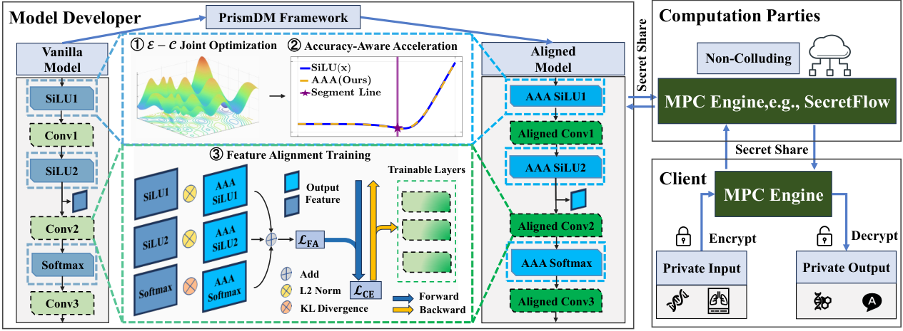

# PrismDM: An Accurate and Efficient Framework for Privacy-Preserving Diffusion Model Sampling

**ACM Multimedia 2026**

[Paper](docs/paper.pdf) · [Supplementary Material](docs/supplementary.pdf)

PrismDM combines accuracy-aware acceleration and feature alignment for efficient diffusion sampling under multi-party computation.



## Installation

Linux, Python 3.10.

```bash
git clone https://github.com/FrankZhang-2003/PrismDM.git
cd PrismDM
python3.10 -m venv .venv
source .venv/bin/activate
pip install -r requirements.txt
```

## Accuracy

Run from the repository root:

```bash
python scripts/sample.py --method vanilla  --num-samples 4 --steps 50 --seed 0
python scripts/sample.py --method cipherdm --num-samples 4 --steps 50 --seed 0
python scripts/sample.py --method prismdm  --num-samples 4 --steps 50 --seed 0
```

Images are saved to `outputs/<method>/`. See [Accuracy](Accuracy/README.md) for checkpoints and dataset generation.

## Efficiency

Install SPU in the same environment:

```bash
pip install -r requirements-mpc.txt
```

Start the three parties in one terminal:

```bash
cd Efficiency/PrismDM
python nodectl.py -c 3pc.json up
```

In another terminal, activate the same environment and run from `Efficiency/PrismDM`:

```bash
PYTHONPATH=. python scripts/flax_sample_silu.py --backend prismdm --sampler ddim --ddim-steps 50
```

Use `--backend vanilla` for the SPU baseline or `--backend cpu` for local inference. See [Efficiency](Efficiency/README.md) for CipherDM, Docker and LAN settings.

Code is organized into `Accuracy/` (quality experiments), `Efficiency/` (MPC timing) and `scripts/` (sampling).

## Citation

```bibtex
@inproceedings{zhang2026prismdm,
  title     = {PrismDM: An Accurate and Efficient Framework for Privacy-Preserving Diffusion Model Sampling},
  author    = {Zhang, Yuhao and Wang, Pinghui and Yang, Guangmingzi and Liu, Yitong and Hou, Zhe and Lei, Zehua and Wang, Haoyang and Liu, Xuhui and Zeng, Juxiang and Ren, Xiaodong and Guan, Xiaohong},
  booktitle = {Proceedings of the 34th ACM International Conference on Multimedia},
  year      = {2026},
  doi       = {10.1145/3767308.3835110}
}
```

Thanks to [SecretFlow-SPU](https://github.com/secretflow/spu) and [denoising-diffusion-pytorch](https://github.com/lucidrains/denoising-diffusion-pytorch). See [NOTICE](NOTICE.md) for third-party notices.
